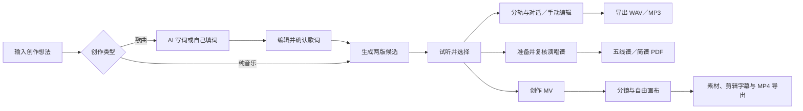

# Osmanthus · AI 音乐创作工作台

**把想法写成歌，再把歌曲变成可以试听、修改和导出的作品。**

面向懂一些音乐、希望借助 AI 完成作曲与编配的创作者，普通创作爱好者也可以使用。以中文流行歌曲为主要验证场景，提供从歌词确认到歌曲生成、分轨编辑、演唱谱和 MV 的连贯工作流程。

[查看源码与运行说明](https://github.com/oniszczukthommy-wq/Osmanthus) · [返回个人主页](https://github.com/oniszczukthommy-wq)

## 用户怎么使用

纯音乐跳过写词、歌词确认及演唱谱。两版歌曲分别使用基础提示词与编曲知识增强方案，最终由用户试听选择。

## 产品特点

| 创作环节 | 工作台提供的能力 |
| --- | --- |
| 从想法开始 | DeepSeek 随机灵感、歌词生成与确认；高级模式可自填歌词。 |
| 试听与选择 | 两版歌曲对比、AI 封面、旋转唱片播放器；时间轴准备后歌词随演唱滚动。 |
| 修改歌曲 | 可视化分轨，在播放中独立开关轨道、调音量；对话与手动操作修改同一份工程，支持撤销和重做。 |
| 配器与编配 | 对可分离声部调整，新增配器或重编先试听候选，再决定是否应用。 |
| 乐谱输出 | 基于实际演唱准备候选谱、复核音高节奏与歌词对应，导出五线谱或简谱 PDF。 |
| MV 创作 | 从歌曲进入自由画布，组织分镜、上传素材、剪辑字幕并导出 MP4；AI 视频接入阿里万相。 |

## 当前验证状态

- **歌曲流程：** 已验证中文歌曲生成、试听、分轨编辑、撤销重做和音频导出。测试歌曲的完成度与听感已获得用户认可。
- **提前试听：** 已实测整曲完成前出声，生成结束后接续成品；上游流速、缓冲和连接稳定性仍未通过持续播放验收，不承诺固定首声时间。
- **乐谱：** 已有通过逐段与整曲人工核对的样例。自动识别对新歌仍可能出现音高、节奏或歌词对齐误差，不能直接当作已校对出版谱。
- **音轨与音色：** 分离可能有串音；新增配器、重新编配及换声效果以已试听样例为准，不保证所有歌曲同样准确自然。
- **MV：** 已有接口、画布和本地剪辑／导出实现；完整成片质量及端到端稳定性仍需继续验证。
- **时长：** 目标为 150–210 秒，已生成符合要求的样例，但模型不能保证每首都达到该范围。

## 如何体验

这是依赖本机工具、模型与 API 的功能原型。临时好友体验需向项目作者获取完整邀请链接，开发电脑保持开机联网；当前共用本机工作台与模型额度，不是独立多用户在线服务。

公开仓库不会保存邀请凭证或 API 密钥。GitHub 项目页用于展示与代码分发，**并不等于已托管了可直接生成歌曲的网站**。

自行运行请阅读 [Osmanthus 源码仓库说明](https://github.com/oniszczukthommy-wq/Osmanthus)。音乐功能需要自行配置 Python、FFmpeg、模型／音源及账号；MV 的基础画布可单独启动。完整功能尚非克隆即可一键运行。

## Windows 开发与使用

另有 WSL2 安装与启动脚本及音频导入入口。Linux 环境已完成真实服务启动、手动编辑、WAV／MP3 导出、重启恢复及 Demucs CPU 推理检查；Windows 实机、GPU、转谱与换声依赖仍需单独验收。这些迁移检查不等于完整产品已经通过 Windows 验收。

## 关于这个仓库

这是 GitHub 个人主页上的项目展示入口，保留 Osmanthus 的名称与标志；运行源码在独立的 [Osmanthus 仓库](https://github.com/oniszczukthommy-wq/Osmanthus)。个人工程、账号配置、受限音源与模型权重不随展示仓库分发。

更新日期：2026-10-31。
